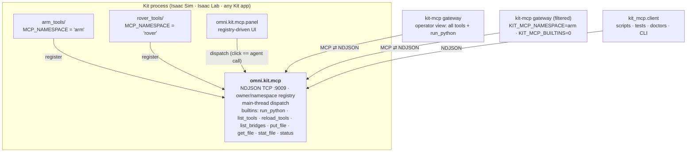

# omni-kit-mcp

https://github.com/user-attachments/assets/14507203-4fae-4e2a-bfbf-894facf8c864

Infrastructure for driving **Omniverse Kit** apps — Isaac Sim, Isaac Lab, or
any Kit-based app — over the **Model Context Protocol**.

**One bridge, one port, per Kit process.** Projects register tools under a
namespace; name collisions between projects are impossible by construction
(two projects can each ship a `play_scene` — they land as `arm.play_scene`
and `rover.play_scene`), so co-loaded projects share the single socket.



## Setup (once per machine)

Register the bridge permanently (afterwards, launches need no flags or env
vars):

```bash
python3 scripts/install.py            # add --dry-run to preview
```

This edits the Kit app's persistent `user.config.json` (the scriptable
equivalent of the Extensions window's AUTOLOAD checkbox): adds `exts/` as a
search path, auto-enables `omni.kit.mcp` + `omni.kit.mcp.panel`, and sets the
bridge port (default **9009**). Restart the app; the bridge binds with the
built-in tools. `--remove` undoes it.

Run it while the app is **down**; a running app overwrites the file on exit
([why](docs/configuration.md#register-while-the-app-is-down)).

Connect an agent/IDE — install the front-end (`pip install -e .` or `uv sync`)
and add to `.mcp.json` (Claude Code, Cursor, etc.):

```json
{
  "mcpServers": {
    "kit": { "command": "kit-mcp" }
  }
}
```

No port needed — the gateway discovers a lone running bridge. Pin one with
`"env": { "OMNI_KIT_MCP_PORT": "9009" }` when several Kit processes run.

That alone is fully usable: `run_python` executes arbitrary Python on Kit's
main thread (persistent sessions supported; saved session vars auto-clear when
a new stage opens — they hold prim/handle references the new stage kills),
which reaches everything in the sim. Tools discovered from the bridge appear as native MCP tools
(`robot_demo.spawn_robot` → `robot_demo__spawn_robot`; dots are illegal in MCP names).

## Adding a project (the contract)

A project is a **plain Python package** — not a Kit extension. It declares a
namespace and either exposes one entrypoint (copy `examples/demo_tools/`) or
none at all ([declared toolsets](docs/tool-authoring.md#declared-toolsets)):

```python
# ~/myproj/isaac/myproj_tools/__init__.py
MCP_NAMESPACE = "robot_demo"                       # defaults to the module name
DOORWAY_ADMISSION = 1                              # the admission contract, docs/protocol.md

def register(registrar):                   # receives an owner-bound registrar
    @registrar.tool("Spawn a robot into the scene.", {"name": {"type": "string"}})
    def spawn_robot(name: str = "robot_1"):
        import omni.usd                    # Kit imports live inside handlers
        ...
        return {"path": f"/World/{name}"}  # payload only — no envelope
```

Register it persistently (once per project):

```bash
python3 scripts/install.py add-project --path ~/myproj/isaac --module myproj_tools
```

Next launch, the bridge advertises `robot_demo.spawn_robot`; the panel grows a `robot_demo`
section; agents see it after `refresh_tools`. Per-launch override instead of
persistence: `KIT_MCP_TOOL_PATHS=~/myproj/isaac KIT_MCP_TOOL_MODULES=myproj_tools`.

> **One registration, three surfaces.** A registered tool isn't just an agent
> verb: the control panel renders it as a clickable widget automatically, and
> the reference client/CLI can call it from scripts — all three go through the
> same dispatch entrance. Write the tool once; button, agent call, and script
> call come with it.

A package with no `register()` is introspected instead: every public function
becomes a tool, its schema derived from the signature. See
[docs/tool-authoring.md](docs/tool-authoring.md) for declared toolsets, the handler
contract and curated per-project agent views.

## Scripting the bridge (no MCP needed)

The bridge's wire protocol is not MCP — the gateway above is the only MCP
speaker. For scripts, tests, and health checks, use the **reference client**
(stdlib-only, single-file, also copyable as-is):

```python
from kit_mcp.client import call, BridgeClient, BridgeError
call("demo.ping", {"message": "hi"})                 # one-shot; endpoint auto-discovered
with BridgeClient() as c:                            # persistent + reconnect
    c.call("run_python", {"code": "result = 1"})     # (pass host=/port= to pin)
```

```bash
python3 -m kit_mcp.client <tool> ['{"json":"params"}'] [--port N]
python3 -m kit_mcp.client --list-bridges          # what's running
# exit codes: 0 success · 1 bridge answered with an error · 2 unreachable
```

With exactly one bridge running you need no port: the client discovers it
([endpoint resolution](docs/protocol.md#endpoint-resolution)).
`import kit_mcp.client` works without the `mcp` SDK installed — only the
gateway needs it.

## What else it does

- **Hot reload** — edit a tool package and reload it without restarting Kit. [docs/tool-authoring.md](docs/tool-authoring.md#hot-reload)
- **Remote files** — ship code and assets to a remote box through the bridge. [docs/tool-authoring.md](docs/tool-authoring.md#remote-files-put_file--get_file--stat_file)
- **Control panel** — every registered tool becomes a clickable widget. [docs/tool-authoring.md](docs/tool-authoring.md#control-panel)
- **Request admission and doorway hold** — one queue with typed refusals, and a way to reserve the bridge for one caller. [docs/protocol.md](docs/protocol.md)
- **Multiple instances and remote access** — one port per Kit process, discovery, binding beyond localhost. [docs/configuration.md](docs/configuration.md)
- **Isaac Lab** — the bridge inside standalone train/play scripts. [docs/isaac-lab.md](docs/isaac-lab.md)
- **Tool-author gotchas** — Kit facts that cost real debugging time. [docs/tool-authoring.md](docs/tool-authoring.md#tool-author-gotchas-kit-facts-that-cost-real-debugging-time)

## Layout

```
exts/omni.kit.mcp/          the bridge extension (protocol, bridge, builtins, autoload)
exts/omni.kit.mcp.panel/    registry-driven control panel (optional)
kit_mcp/                    the MCP front-end (FastMCP server, TCP client to the bridge)
scripts/install.py          permanent registration: base install + add-project
examples/demo_tools/        the template tool package — copy to onboard a project
tests/                      protocol / registry / autoload / live-socket tests (no Kit needed)
docs/                       protocol, configuration, tool authoring, Isaac Lab
```

## Development

```bash
python3 -m pytest tests/    # the socket server runs under plain asyncio in tests
```